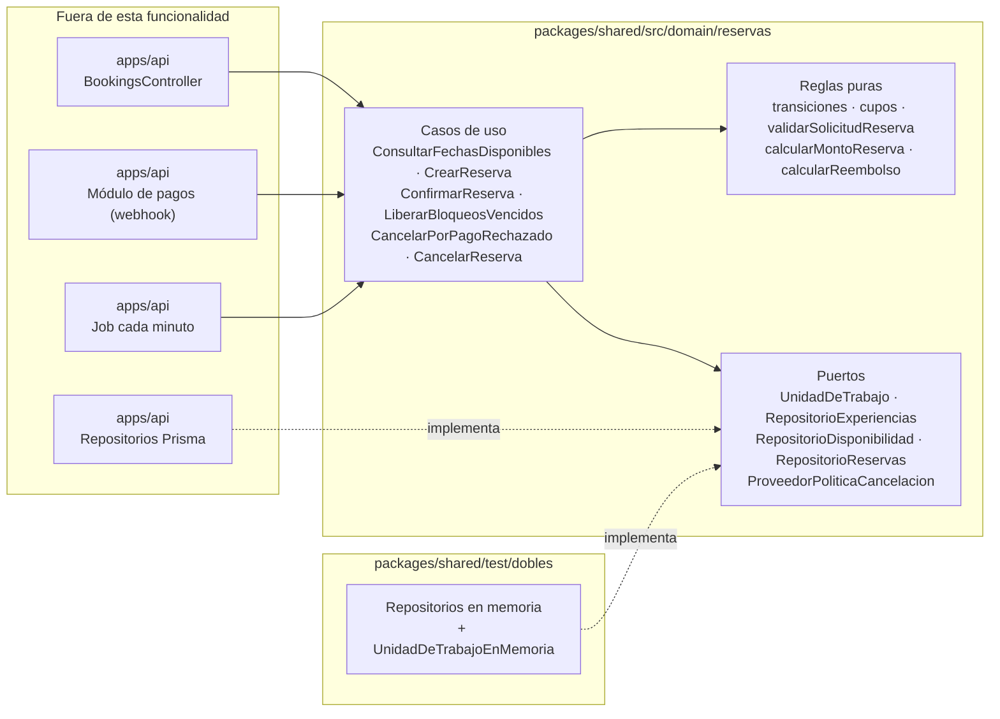
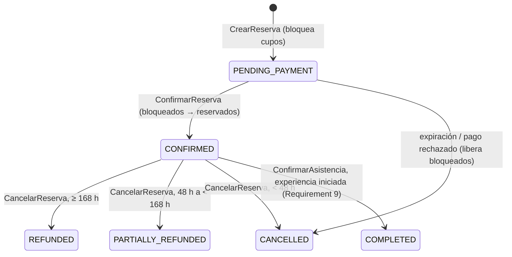
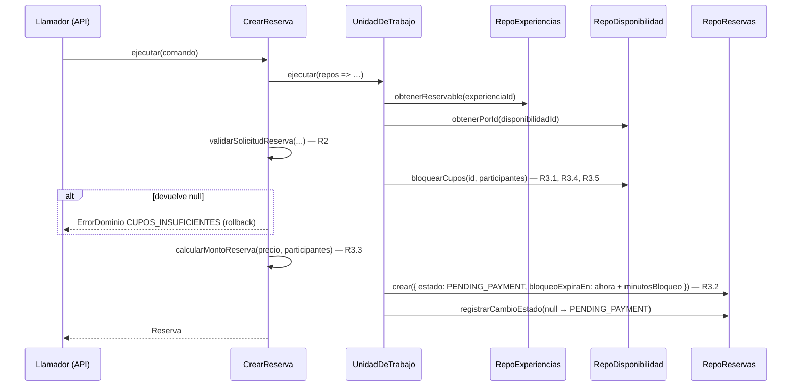
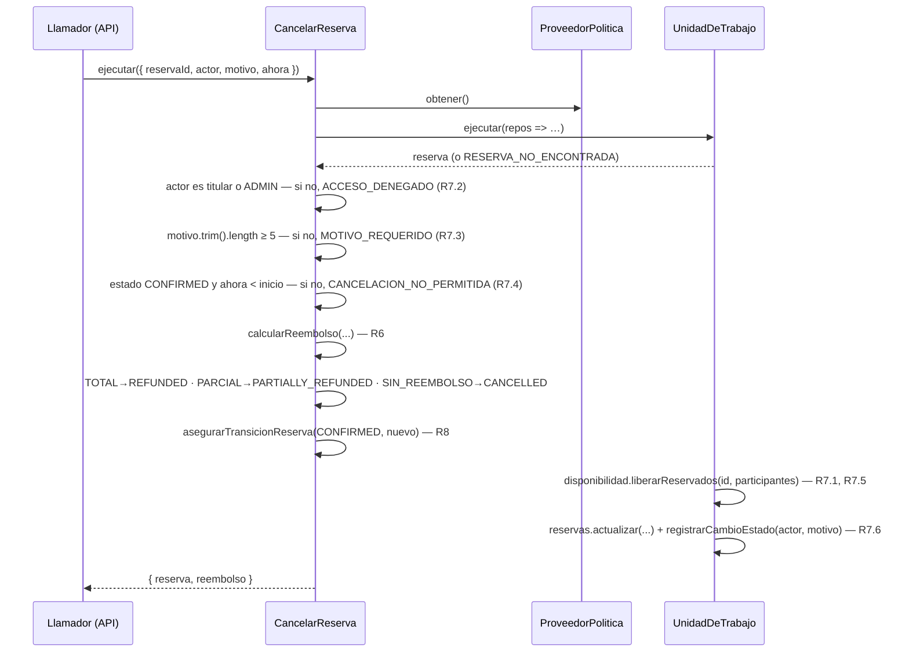

# Diseño técnico — Gestión de cupos y cancelación de reservas

> **Funcionalidad:** `reservas-cupos-cancelacion`
> **Estado:** APROBADO. Núcleo IMPLEMENTADO (2026-10-06, 199 pruebas en verde, 100 % de cobertura). Ampliación R6.7 + Requirement 9 **diseñada y pendiente de implementación** (tareas 9–11)
> **Base:** [requirements.md](requirements.md) (aprobado el 2026-10-06, con los supuestos A-23, A-24 y A-25 aceptados y 50 % como valor de ejemplo de A-03)
> **Steering aplicado:** #[[file:.kiro/steering/tech.md]] · #[[file:steering/reglas-negocio.md]]

## Overview

El núcleo de reservas se implementa en `packages/shared` como TypeScript puro, en tres niveles:

1. **Reglas puras**: funciones sin E/S que reciben todo por parámetro, incluido `ahora`.
2. **Casos de uso**: clases que orquestan las reglas y acceden a los datos solo a través de **puertos** (interfaces).
3. **Dobles de prueba**: implementaciones en memoria de los puertos, para ejecutar todos los criterios de aceptación con Vitest, sin base de datos.

Más adelante, el backend NestJS implementará los mismos puertos con Prisma y llamará a estos casos de uso sin reescribir ninguna regla.

## Architecture



**Reglas de dependencia:**

- Las reglas puras no dependen de nada, salvo de los errores y las constantes compartidas.
- Los casos de uso dependen de las reglas y de los puertos.
- Ningún archivo de `src/` importa frameworks, Prisma ni Node APIs (`fs`, `crypto`…).

### Estructura de archivos

```text
package.json                          # raíz: npm workspaces ["packages/*"] (apps/* se agrega después)
tsconfig.base.json                    # strict, ES2022, moduleResolution bundler
packages/shared/
├── package.json                      # @amaru/shared · scripts: test, test:coverage, typecheck
├── tsconfig.json
├── vitest.config.ts                  # cobertura v8; umbral 100 % en src/
├── src/
│   ├── index.ts
│   ├── constants/
│   │   ├── estados-reserva.ts        # ESTADOS_RESERVA, ESTADOS_DISPONIBILIDAD, ESTADOS_PUBLICACION
│   │   └── politica-cancelacion.ts   # HORAS_REEMBOLSO_TOTAL = 168, HORAS_REEMBOLSO_PARCIAL = 48
│   └── domain/
│       ├── errores/
│       │   └── error-dominio.ts      # ErrorDominio, CODIGOS_ERROR, MENSAJES_ERROR
│       ├── dinero/
│       │   ├── centimos.ts           # asegurarCentimos, asegurarPorcentaje, aplicarPorcentaje
│       │   └── centimos.test.ts
│       └── reservas/
│           ├── tipos.ts              # Disponibilidad, ExperienciaReservable, Reserva, Actor…
│           ├── puertos.ts            # interfaces de repositorio y UnidadDeTrabajo
│           ├── transiciones-reserva.ts (+ .test.ts)
│           ├── cupos.ts              (+ .test.ts)
│           ├── bloqueo.ts            (+ .test.ts)   # calcularExpiracionBloqueo, bloqueoVencido
│           ├── validar-solicitud-reserva.ts (+ .test.ts)
│           ├── calcular-monto-reserva.ts (+ .test.ts)
│           ├── calcular-reembolso.ts (+ .test.ts)   # + estadoTrasCancelacion
│           ├── propiedades-reservas.test.ts          # Property 1–8 con fast-check
│           ├── casos-de-uso/
│           │   ├── comun.ts          # obtenerReservaOFallar, aplicarTransicion, cancelarPendientePorSistema
│           │   ├── consultar-fechas-disponibles.ts (+ .test.ts)
│           │   ├── crear-reserva.ts (+ .test.ts)
│           │   ├── confirmar-reserva.ts (+ .test.ts)
│           │   ├── liberar-bloqueos.ts (+ .test.ts)   # LiberarBloqueosVencidos, CancelarPorPagoRechazado
│           │   ├── cancelar-reserva.ts (+ .test.ts)
│           │   ├── consultar-reembolso.ts (+ .test.ts)      # PENDIENTE — tarea 9 (R6.7)
│           │   └── confirmar-asistencia.ts (+ .test.ts)     # PENDIENTE — tarea 10 (Requirement 9)
│           └── index.ts
└── test/
    └── dobles/
        ├── almacen-en-memoria.ts     # datos, instantánea y restauración (rollback)
        ├── repositorios-en-memoria.ts
        ├── unidad-de-trabajo-en-memoria.ts
        └── fabricas.ts               # AHORA fijo, crearDisponibilidad(), prepararEscenario(), errorDe()…
```

Todos los archivos tienen menos de 250 líneas y una sola responsabilidad (regla de tech.md).

## Data Models

### Constantes y tipos cerrados

```ts
export const ESTADOS_RESERVA = [
  'PENDING_PAYMENT', 'CONFIRMED', 'COMPLETED',
  'CANCELLED', 'REFUNDED', 'PARTIALLY_REFUNDED',
] as const;
export type EstadoReserva = (typeof ESTADOS_RESERVA)[number];

export const ESTADOS_DISPONIBILIDAD = ['AVAILABLE', 'FULL', 'BLOCKED', 'CLOSED'] as const;
export type EstadoDisponibilidad = (typeof ESTADOS_DISPONIBILIDAD)[number];

export const ESTADOS_PUBLICACION = [
  'DRAFT', 'PENDING_REVIEW', 'PUBLISHED', 'OBSERVED', 'REJECTED', 'UNPUBLISHED',
] as const;
export type EstadoPublicacion = (typeof ESTADOS_PUBLICACION)[number];

export const MOTIVOS_CANCELACION_SISTEMA = ['EXPIRED', 'PAYMENT_REJECTED'] as const;
export const TIPOS_REEMBOLSO = ['TOTAL', 'PARCIAL', 'SIN_REEMBOLSO'] as const;
export type TipoReembolso = (typeof TIPOS_REEMBOLSO)[number];

// Fijados por RN-07 (especificación), no configurables
export const HORAS_REEMBOLSO_TOTAL = 168;
export const HORAS_REEMBOLSO_PARCIAL = 48;
```

### Entidades del dominio

```ts
export interface ExperienciaReservable {
  id: string;
  estado: EstadoPublicacion;
  precioPorPersonaCentimos: number;  // entero (RN-02: lo fija el artesano o la comunidad)
}

export interface Disponibilidad {
  id: string;
  experienciaId: string;
  inicio: Date;                      // instante absoluto ya resuelto (A-24)
  capacidadTotal: number;
  capacidadReservada: number;
  capacidadBloqueada: number;
  estado: EstadoDisponibilidad;
  declaradaPor: string | null;       // id del coordinador que la declaró (RN-06)
}

export interface Reserva {
  id: string;
  experienciaId: string;
  disponibilidadId: string;
  compradorId: string;
  participantes: number;
  montoCentimos: number;
  estado: EstadoReserva;
  bloqueoExpiraEn: Date | null;
  referenciaPago: string | null;
  motivoCancelacion: string | null;
  reembolsoCentimos: number | null;
  canceladaEn: Date | null;
}

export interface CambioEstadoReserva {
  reservaId: string;
  desde: EstadoReserva | null;       // null = creación
  hacia: EstadoReserva;
  actorId: string | null;            // null = sistema (job o webhook)
  motivo: string | null;
  ocurridoEn: Date;
}

export interface Actor { id: string; roles: readonly Rol[]; }
export type Rol = 'BUYER' | 'ARTISAN' | 'COORDINATOR' | 'ADMIN';

export interface PoliticaCancelacion {
  porcentajeReembolsoParcial: number;  // 0–100, configurable desde el sistema (A-03)
}

export interface ResultadoReembolso {
  tipo: TipoReembolso;
  montoCentimos: number;
  horasAnticipacion: number;
}

export interface FechaDisponible {
  disponibilidadId: string;
  inicio: Date;
  cuposRestantes: number;
  seleccionable: boolean;
}
```

### Correspondencia con la base de datos ([modelo-inicial.md](../../../docs/base-de-datos/modelo-inicial.md))

| Dominio | Tabla.columna |
|---|---|
| `Disponibilidad.capacidadTotal` / `capacidadReservada` / `capacidadBloqueada` | `availability.total_capacity` / `reserved_capacity` / `held_capacity` |
| `Disponibilidad.inicio` | `availability.date` + `start_time` (convertidos desde `America/Lima`) |
| `Reserva.montoCentimos` / `reembolsoCentimos` | `bookings.amount_cents` / `refund_cents` |
| `Reserva.bloqueoExpiraEn` | `bookings.hold_expires_at` |
| `CambioEstadoReserva` | `booking_status_history` |
| `PoliticaCancelacion.porcentajeReembolsoParcial` | `system_settings['cancelacion.porcentaje_parcial']` |

Restricción que respalda R3.4 en la BD: `CHECK(reserved_capacity >= 0 AND held_capacity >= 0 AND reserved_capacity + held_capacity <= total_capacity)`.

## Components and Interfaces

### Reglas puras

| Función | Firma | Requisitos |
|---|---|---|
| `puedeCambiarEstadoReserva` | `(actual, siguiente) => boolean` | R8.1, R8.2 |
| `asegurarTransicionReserva` | `(actual, siguiente) => void` (lanza `TRANSICION_INVALIDA`) | R8.3, R8.4 |
| `calcularCuposRestantes` | `(d: Disponibilidad) => number` | R1.2 |
| `estadoSegunCupos` | `(d: Disponibilidad) => EstadoDisponibilidad`: mantiene `BLOCKED`/`CLOSED`; si no, `FULL` cuando quedan 0 cupos y `AVAILABLE` en otro caso | R1.3, R3.5, R5.3, R7.5 |
| `validarSolicitudReserva` | `(solicitud) => asserts solicitud is SolicitudReservaValida`. Una fecha `FULL` cuenta como habilitada y responde `CUPOS_INSUFICIENTES` (aclaración de R2) | R2.1–R2.5 |
| `calcularMontoReserva` | `(precioPorPersonaCentimos, participantes) => number` | R3.3, RNF-R3 |
| `calcularReembolso` | `({ montoPagadoCentimos, inicio, canceladoEn, politica }) => ResultadoReembolso` | R6.1–R6.6 |
| `asegurarCentimos` | `(valor, campo) => void` (lanza `MONTO_INVALIDO`) | RNF-R3 |
| `asegurarPorcentaje` | `(porcentaje) => void` (lanza `POLITICA_INVALIDA`) | R6.5 |
| `calcularExpiracionBloqueo` / `bloqueoVencido` | `(ahora, minutos) => Date` / `(reserva, ahora) => boolean` (sin expiración = vencida) | R3.2, R4.4, R5.1 |
| `estadoTrasCancelacion` | `TOTAL → REFUNDED`, `PARCIAL → PARTIALLY_REFUNDED`, `SIN_REEMBOLSO → CANCELLED` | R7.1 |
| `aplicarPorcentaje` | `(centimos, porcentaje) => number`, con `Math.round` y acotado a `[0, centimos]` | R6.4 |

**Tabla de transiciones** (una única fuente, usada por `puedeCambiarEstadoReserva`):

```ts
const TRANSICIONES_RESERVA: Record<EstadoReserva, readonly EstadoReserva[]> = {
  PENDING_PAYMENT: ['CONFIRMED', 'CANCELLED'],
  CONFIRMED: ['COMPLETED', 'CANCELLED', 'REFUNDED', 'PARTIALLY_REFUNDED'],
  COMPLETED: [], CANCELLED: [], REFUNDED: [], PARTIALLY_REFUNDED: [],
};
```



**Algoritmo de `calcularReembolso`:**

```text
asegurarCentimos(montoPagado)
si politica.porcentajeReembolsoParcial no es finito o está fuera de [0, 100] → POLITICA_INVALIDA
horas = (inicio − canceladoEn) / 3 600 000           // horas exactas, con decimales
si horas ≥ 168        → { TOTAL, montoPagado }
si horas ≥ 48         → { PARCIAL, aplicarPorcentaje(montoPagado, porcentaje) }
en otro caso          → { SIN_REEMBOLSO, 0 }
```

Se comparan horas con decimales, no días redondeados. Así, 47 h 59 min da `SIN_REEMBOLSO` y 48 h exactas da `PARCIAL` (A-04).

### Puertos

```ts
export interface RepositorioExperiencias {
  obtenerReservable(id: string): Promise<ExperienciaReservable | null>;
}

export interface RepositorioDisponibilidad {
  obtenerPorId(id: string): Promise<Disponibilidad | null>;
  listarPorExperienciaDesde(experienciaId: string, desde: Date): Promise<Disponibilidad[]>;
  /** Atómico: suma `cantidad` a bloqueada solo si caben; recalcula el estado. Devuelve null si no caben. */
  bloquearCupos(id: string, cantidad: number): Promise<Disponibilidad | null>;
  /** Atómico: bloqueada −= cantidad; reservada += cantidad. */
  confirmarCupos(id: string, cantidad: number): Promise<Disponibilidad>;
  /** Atómico: bloqueada −= cantidad; recalcula el estado. */
  liberarBloqueados(id: string, cantidad: number): Promise<Disponibilidad>;
  /** Atómico: reservada −= cantidad; recalcula el estado. */
  liberarReservados(id: string, cantidad: number): Promise<Disponibilidad>;
}

export interface RepositorioReservas {
  obtenerPorId(id: string): Promise<Reserva | null>;
  crear(datos: Omit<Reserva, 'id'>): Promise<Reserva>;
  actualizar(reserva: Reserva): Promise<void>;
  listarPendientesVencidas(ahora: Date): Promise<Reserva[]>;
  registrarCambioEstado(cambio: CambioEstadoReserva): Promise<void>;
}

export interface Repositorios {
  experiencias: RepositorioExperiencias;
  disponibilidad: RepositorioDisponibilidad;
  reservas: RepositorioReservas;
}

/** Ejecuta el trabajo en una transacción. Si se lanza un error, no persiste nada. */
export interface UnidadDeTrabajo {
  ejecutar<T>(trabajo: (repos: Repositorios) => Promise<T>): Promise<T>;
}

export interface ProveedorPoliticaCancelacion {
  obtener(): Promise<PoliticaCancelacion>;
}
```

**Contrato de atomicidad:** las cuatro operaciones de cupos se implementan como un único `UPDATE` condicional (Prisma) o como un bloque síncrono (memoria). Si una liberación dejaría un contador negativo, lanzan `CUPOS_INCONSISTENTES`. Ese error señala un fallo del sistema, no una acción del usuario.

### Casos de uso

Todos reciben sus dependencias por constructor y exponen `ejecutar(comando)`. El comando siempre incluye `ahora: Date` (RNF-R2).

| Caso de uso | Comando | Resultado | Requisitos |
|---|---|---|---|
| `ConsultarFechasDisponibles` | `{ experienciaId, ahora }` | `FechaDisponible[]` | R1 |
| `CrearReserva` (config `minutosBloqueo`) | `{ experienciaId, disponibilidadId, compradorId, participantes, ahora }` | `Reserva` | R2, R3 |
| `ConfirmarReserva` | `{ reservaId, referenciaPago, ahora }` | `Reserva` | R4 |
| `LiberarBloqueosVencidos` | `{ ahora }` | `{ liberadas: number }` | R5.1, R5.3, R5.4 |
| `CancelarPorPagoRechazado` | `{ reservaId, ahora }` | `Reserva` | R5.2, R5.3 |
| `CancelarReserva` | `{ reservaId, actor, motivo, ahora }` | `{ reserva, reembolso }` | R6, R7 |
| `ConsultarReembolso` *(pendiente)* | `{ reservaId, actor, ahora }` | `ResultadoReembolso` | R6.7 |
| `ConfirmarAsistencia` *(pendiente)* | `{ reservaId, actor, ahora }` | `Reserva` | R9 |

#### `CrearReserva`



#### `ConfirmarReserva`

1. Si la reserva no existe → `RESERVA_NO_ENCONTRADA`. Si `referenciaPago` está vacía → `REFERENCIA_PAGO_REQUERIDA`.
2. Si está `CONFIRMED` con la **misma** referencia → devuelve la reserva sin cambios (R4.3). Si tiene **otra** referencia → `PAGO_DUPLICADO`. El módulo de pagos debe devolver ese segundo cobro.
3. Si no está `PENDING_PAYMENT`, o `bloqueoExpiraEn ≤ ahora` → `RESERVA_EXPIRADA` (R4.4). En ese caso no libera cupos aquí; lo hace `LiberarBloqueosVencidos`, que es idempotente.
4. Llama a `asegurarTransicionReserva` → `confirmarCupos` → actualiza el estado, la referencia y `bloqueoExpiraEn = null` → registra el historial con `actorId = null`.

#### `LiberarBloqueosVencidos` y `CancelarPorPagoRechazado`

- `LiberarBloqueosVencidos` lista las reservas vencidas y procesa **cada una en su propia transacción**: vuelve a leer la reserva y, si sigue `PENDING_PAYMENT` y vencida, la cancela con motivo `EXPIRED` y llama a `liberarBloqueados`. Releer garantiza la idempotencia (R5.4) aunque dos ejecuciones se solapen.
- `CancelarPorPagoRechazado`:
  - `PENDING_PAYMENT` → la cancela con motivo `PAYMENT_REJECTED` y libera los cupos bloqueados;
  - ya `CANCELLED` → no hace nada (idempotente);
  - cualquier otro estado → `TRANSICION_INVALIDA`.

#### `CancelarReserva`



La autorización se valida **antes** que el estado, para no revelar a terceros información de reservas ajenas.

#### `ConsultarReembolso` — vista previa (pendiente, R6.7)

Para no duplicar las validaciones de `CancelarReserva` (regla de tech.md), primero se **extraen** a `comun.ts` dos funciones que ambos casos de uso reutilizan:

```ts
/** RESERVA_NO_ENCONTRADA o ACCESO_DENEGADO si el actor no es el titular ni ADMIN (R7.2). */
export async function obtenerReservaAutorizada(
  reservas: RepositorioReservas,
  reservaId: string,
  actor: Actor,
): Promise<Reserva>;

/** CANCELACION_NO_PERMITIDA si la reserva no está CONFIRMED o la experiencia ya inició (R7.4). */
export async function asegurarCancelable(
  disponibilidades: RepositorioDisponibilidad,
  reserva: Reserva,
  ahora: Date,
): Promise<Disponibilidad>;
```

- `CancelarReserva` queda así: `obtenerReservaAutorizada` → validar el motivo → `asegurarCancelable` → calcular → aplicar. El orden de validación no cambia (autorización → motivo → estado).
- `ConsultarReembolso`: `proveedorPolitica.obtener()` → `unidadDeTrabajo.ejecutar` → `obtenerReservaAutorizada` → `asegurarCancelable` → `calcularReembolso({ montoPagadoCentimos, inicio, canceladoEn: ahora, politica })`. **No** llama a `actualizar`, `registrarCambioEstado` ni a ninguna operación de cupos, y no pide motivo.
- Las pruebas existentes de `cancelar-reserva.test.ts` deben seguir pasando sin cambios. Esa es la evidencia de que la refactorización no alteró el comportamiento.

#### `ConfirmarAsistencia` (pendiente, Requirement 9)

1. `obtenerReservaOFallar` → `RESERVA_NO_ENCONTRADA`.
2. Obtiene la disponibilidad de la reserva. Para autorizar, se exige que el actor tenga rol `ADMIN`, **o** que tenga rol `COORDINATOR` y `actor.id === disponibilidad.declaradaPor`. Si no → `ACCESO_DENEGADO` (R9.2, R9.3). Si la disponibilidad no existe, también se responde `ACCESO_DENEGADO`, porque no hay coordinador que pueda confirmar.
3. Si `ahora < disponibilidad.inicio` → `ASISTENCIA_NO_PERMITIDA` (R9.4).
4. `aplicarTransicion(reservas, reserva, { estado: COMPLETED }, actor.id, null, ahora)`. Si la reserva no está `CONFIRMED`, la función central lanza `TRANSICION_INVALIDA` (R9.5).
5. **No** toca los cupos (R9.6).

## Correctness Properties

Propiedades que deben cumplirse **para cualquier entrada válida**, no solo para los ejemplos de los escenarios. Se verifican con pruebas basadas en propiedades (`fast-check`, 200 casos generados por propiedad) en `propiedades-reservas.test.ts`.

### Property 1: Invariante de cupos

*Para cualquier* secuencia de `CrearReserva`, `ConfirmarReserva`, `LiberarBloqueosVencidos`, `CancelarPorPagoRechazado` y `CancelarReserva` sobre una disponibilidad, siempre se cumplen `0 ≤ capacidadReservada`, `0 ≤ capacidadBloqueada` y `capacidadReservada + capacidadBloqueada ≤ capacidadTotal`.

**Validates: Requirements 3.4, 5.1, 5.2, 7.1**

### Property 2: Conservación de cupos

*Para cualquier* secuencia de operaciones, la suma de participantes de las reservas `PENDING_PAYMENT` es igual a `capacidadBloqueada`, y la de las reservas `CONFIRMED` es igual a `capacidadReservada`.

**Validates: Requirements 3.1, 4.1, 5.1, 7.1**

### Property 3: Estado coherente con los cupos

*Para toda* disponibilidad que no esté `BLOCKED` ni `CLOSED`, el estado es `FULL` si, y solo si, los cupos restantes son 0.

**Validates: Requirements 1.3, 3.5, 5.3, 7.5**

### Property 4: Reembolso acotado

*Para todo* monto entero ≥ 0, toda anticipación y todo porcentaje en [0, 100], el reembolso es un entero y cumple `0 ≤ reembolso ≤ monto`.

**Validates: Requirements 6.4**

### Property 5: Reembolso monótono

*Para el* mismo monto y la misma política, cancelar con más horas de anticipación nunca devuelve menos dinero.

**Validates: Requirements 6.1, 6.2, 6.3**

### Property 6: Estados finales sin salida

*Para todo* estado destino, `puedeCambiarEstadoReserva` devuelve `false` si el estado actual es `COMPLETED`, `CANCELLED`, `REFUNDED` o `PARTIALLY_REFUNDED`.

**Validates: Requirements 8.2**

### Property 7: Idempotencia

*Para todo* n ≥ 1, ejecutar `LiberarBloqueosVencidos` n veces con el mismo `ahora` deja el mismo estado que ejecutarlo una vez. Lo mismo vale para `ConfirmarReserva` con la misma referencia de pago.

**Validates: Requirements 4.3, 5.4**

### Property 8: Rollback ante errores

*Para todo* caso de uso que termine con `ErrorDominio`, los repositorios quedan exactamente como estaban antes de ejecutarlo.

**Validates: Requirements 2.5, 3.4, 7.4**

### Property 9: La vista previa coincide con la cancelación y no modifica nada (pendiente)

*Para toda* reserva `CONFIRMED` y todo momento anterior a su inicio, `ConsultarReembolso` devuelve exactamente el mismo `ResultadoReembolso` que `CancelarReserva` con el mismo `ahora`, y el almacén queda idéntico tras la consulta.

**Validates: Requirements 6.7**

### Property 10: Confirmar la asistencia conserva los cupos (pendiente)

*Para toda* reserva `CONFIRMED` cuya experiencia ya inició, `ConfirmarAsistencia` deja `capacidadReservada` y `capacidadBloqueada` exactamente iguales.

**Validates: Requirements 9.6**

## Error Handling

```ts
export const CODIGOS_ERROR = [
  'EXPERIENCIA_NO_PUBLICADA', 'FECHA_NO_DISPONIBLE', 'PARTICIPANTES_INVALIDOS',
  'CUPOS_INSUFICIENTES', 'CUPOS_INCONSISTENTES', 'RESERVA_NO_ENCONTRADA',
  'RESERVA_EXPIRADA', 'REFERENCIA_PAGO_REQUERIDA', 'PAGO_DUPLICADO',
  'POLITICA_INVALIDA', 'CONFIGURACION_INVALIDA', 'MONTO_INVALIDO', 'ACCESO_DENEGADO', 'MOTIVO_REQUERIDO',
  'CANCELACION_NO_PERMITIDA', 'TRANSICION_INVALIDA',
  'ASISTENCIA_NO_PERMITIDA', // pendiente — tarea 10
] as const;
export type CodigoError = (typeof CODIGOS_ERROR)[number];

export class ErrorDominio extends Error {
  constructor(readonly codigo: CodigoError, readonly detalles: Record<string, unknown> = {}) {
    super(MENSAJES_ERROR[codigo]);
    this.name = 'ErrorDominio';
  }
}
```

| Código | Mensaje (español) | HTTP previsto en la API |
|---|---|---|
| `EXPERIENCIA_NO_PUBLICADA` | La experiencia no está disponible para reservas. | 409 |
| `FECHA_NO_DISPONIBLE` | La fecha seleccionada no está disponible. | 409 |
| `PARTICIPANTES_INVALIDOS` | Indica un número de participantes válido (1 o más). | 422 |
| `CUPOS_INSUFICIENTES` | No quedan cupos suficientes para esa fecha. | 409 |
| `CUPOS_INCONSISTENTES` | Error interno de cupos. Inténtalo más tarde. | 500 |
| `RESERVA_NO_ENCONTRADA` | La reserva no existe. | 404 |
| `RESERVA_EXPIRADA` | El tiempo para pagar esta reserva venció. | 409 |
| `REFERENCIA_PAGO_REQUERIDA` | Falta la referencia de pago. | 422 |
| `PAGO_DUPLICADO` | La reserva ya fue pagada con otra operación. | 409 |
| `POLITICA_INVALIDA` | La política de cancelación está mal configurada. | 500 |
| `CONFIGURACION_INVALIDA` | La configuración del sistema de reservas no es válida. | 500 (al arrancar) |
| `MONTO_INVALIDO` | El monto debe ser un número entero de céntimos, no negativo. | 422 |
| `ACCESO_DENEGADO` | No tienes permiso para realizar esta acción. | 403 |
| `MOTIVO_REQUERIDO` | Indica el motivo de la cancelación (mínimo 5 caracteres). | 422 |
| `CANCELACION_NO_PERMITIDA` | Esta reserva ya no se puede cancelar. | 409 |
| `ASISTENCIA_NO_PERMITIDA` *(pendiente)* | La asistencia solo se puede confirmar cuando la experiencia ya empezó. | 409 |
| `TRANSICION_INVALIDA` | Cambio de estado no permitido. | 409 |

Cualquier error lanzado dentro de `UnidadDeTrabajo.ejecutar` revierte todos los cambios de la operación.

> **Decisiones de diseño nuevas** (no cambian reglas de negocio, solo cubren casos de error): `PAGO_DUPLICADO`, `REFERENCIA_PAGO_REQUERIDA`, `CUPOS_INCONSISTENTES` y `CONFIGURACION_INVALIDA` (minutosBloqueo debe ser un entero ≥ 1).

> **Aritmética del reembolso parcial:** `aplicarPorcentaje` convierte el porcentaje a puntos básicos y opera con enteros, así el redondeo de medio céntimo hacia arriba es exacto y no depende de errores de coma flotante. El porcentaje admite hasta dos decimales.

## Testing Strategy

### Dobles de prueba (memoria)

- **`RepositoriosEnMemoria`**: guarda los datos en `Map`. Las operaciones de cupos son bloques síncronos, sin `await` entre la comprobación y la escritura, así que son atómicas en el bucle de eventos. Recalculan el estado con `estadoSegunCupos`, la misma regla de producción.
- **`UnidadDeTrabajoEnMemoria`**:
  - **serializa** las transacciones con una cola de promesas (mutex);
  - toma una **instantánea** (`structuredClone`) antes del trabajo y la **restaura** si hay error.
  - Así se pueden probar el rollback y la competencia (R3.4) con `Promise.all`.
- **`fabricas.ts`**: constructores con valores por defecto válidos (experiencia `PUBLISHED`, precio 15000, capacidad 10, inicio dentro de 10 días), para que cada prueba declare solo lo que le importa.

> La atomicidad real de PostgreSQL se verificará con pruebas de integración cuando se implementen los repositorios Prisma (fuera de alcance).

### Niveles de prueba

| Nivel | Archivo | Qué verifica |
|---|---|---|
| Regla pura | `transiciones-reserva.test.ts` | Las 36 combinaciones de estados (6×6), con `it.each` |
| Regla pura | `calcular-reembolso.test.ts` | 168 h, 167 h 59 min, 48 h, 47 h 59 min, 0 h, negativas, porcentajes 0/100/33.33, −1, 101, `NaN`, monto no entero |
| Regla pura | `cupos.test.ts`, `validar-solicitud-reserva.test.ts`, `calcular-monto-reserva.test.ts`, `centimos.test.ts` | Cada rama de R1.2–R1.3, R2.1–R2.5 y RNF-R3 |
| Caso de uso | `*.test.ts` en `casos-de-uso/` | Cada criterio R*n.m* y cada escenario Dado–Cuando–Entonces, con repositorios en memoria |
| Propiedades | `propiedades-reservas.test.ts` | P1–P8 con secuencias y valores generados por `fast-check` (P9 y P10 pendientes) |

- **Nombres trazables:** `it('R6.2 — 48 h exactas da reembolso PARCIAL', …)`.
- **Cobertura:** `vitest --coverage` con umbral del **100 %** de ramas, líneas y funciones en `src/domain`. Si no se alcanza, el comando falla.
- **Tiempo determinista:** se usa un `ahora` fijo (`2026-10-06T12:00:00-05:00`). No hay `sleep` ni temporizadores reales.

### Matriz de trazabilidad

| Requisito | Componente | Prueba |
|---|---|---|
| R1 | `ConsultarFechasDisponibles`, `calcularCuposRestantes`, `estadoSegunCupos` | `consultar-fechas-disponibles.test.ts`, `cupos.test.ts` |
| R2 | `validarSolicitudReserva` | `validar-solicitud-reserva.test.ts`, `crear-reserva.test.ts` |
| R3 | `CrearReserva`, `bloquearCupos`, `calcularMontoReserva` | `crear-reserva.test.ts`, `calcular-monto-reserva.test.ts` |
| R4 | `ConfirmarReserva` | `confirmar-reserva.test.ts` |
| R5 | `LiberarBloqueosVencidos`, `CancelarPorPagoRechazado` | `liberar-bloqueos.test.ts` |
| R6 | `calcularReembolso`, `aplicarPorcentaje` | `calcular-reembolso.test.ts`, `centimos.test.ts` |
| R7 | `CancelarReserva` | `cancelar-reserva.test.ts` |
| R8 | `puedeCambiarEstadoReserva`, `asegurarTransicionReserva` | `transiciones-reserva.test.ts` |
| R6.7 *(pendiente)* | `ConsultarReembolso`, `obtenerReservaAutorizada`, `asegurarCancelable` | `consultar-reembolso.test.ts`, `cancelar-reserva.test.ts` |
| R9 *(pendiente)* | `ConfirmarAsistencia` | `confirmar-asistencia.test.ts` |
| P1–P8 | Todos los casos de uso y reglas | `propiedades-reservas.test.ts` |
| RNF-R1…R5 | Todo `src/domain` | Umbral de cobertura + `npm run typecheck` |

## Dependencias y configuración

| Paquete | Uso | Tipo |
|---|---|---|
| `typescript` | Compilación y `tsc --noEmit` | dev (raíz) |
| `vitest` | Pruebas unitarias | dev (shared) |
| `@vitest/coverage-v8` | Cobertura con umbral | dev (shared) |
| `fast-check` | Pruebas basadas en propiedades (P1–P8) | dev (shared) |

- No se agrega **ninguna** dependencia de producción.
- Esta funcionalidad no necesita variables de entorno. `minutosBloqueo` llega por constructor; en la API saldrá de `PAYMENT_HOLD_MINUTES`.
- ESLint y Prettier (S1-01) se configuran en una tarea aparte del Sprint 1, para no mezclar alcances.

## Riesgos y pendientes

| Riesgo | Mitigación |
|---|---|
| La atomicidad en memoria no prueba la concurrencia real de PostgreSQL | Contrato de puerto documentado (sección Puertos) + restricción `CHECK` en BD + pruebas de integración futuras |
| Pago aprobado después de que expiró el bloqueo | `RESERVA_EXPIRADA` permite que el módulo de pagos devuelva el dinero. Conviene que `minutosBloqueo` sea mayor que la vigencia del checkout en la pasarela |
| El porcentaje parcial real no está definido (A-03) | Es un parámetro. Cuando se defina, no hay que cambiar código |
| Hora de verano o cambios de zona horaria | Perú no usa horario de verano. El cálculo trabaja con instantes UTC absolutos (A-24) |
