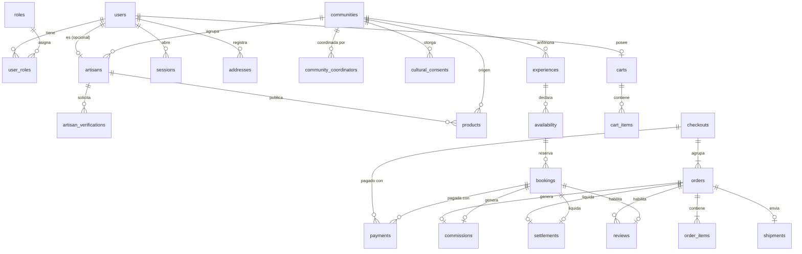

# Modelo inicial de base de datos — AMARU-MDD v1.0

> Estado: **PROPUESTA — pendiente de confirmación**. Motor: PostgreSQL 16 mediante Prisma.
> Las tablas marcadas con ➕ no aparecen en la lista mínima de la especificación (§17); se añaden porque un requisito concreto las necesita. La columna "Requisito" lo justifica.

## Convenciones

- Claves primarias `id UUID` (`@default(uuid())`).
- Todas las tablas tienen `created_at` y `updated_at` (`timestamptz`). En la base de datos se usa `snake_case` y en Prisma `camelCase` mediante `@map`.
- **Dinero en céntimos enteros (`INTEGER`)** y moneda `PEN`. Se evita el error de redondeo de los decimales de coma flotante. Ejemplo: S/ 120.50 → `12050`.
- **Tasas en puntos básicos (`INTEGER`)**. Ejemplo: 12 % → `1200`.
- Borrado lógico (`deleted_at`) en usuarios, comunidades, productos, experiencias y reseñas. Pedidos, pagos, reservas, comisiones, liquidaciones y auditoría **nunca** se borran.
- Historial de estados en tablas `*_status_history` para pedidos, reservas, publicaciones y verificaciones.

## Tablas

### Identidad y acceso

| Tabla | Columnas clave | Restricciones / índices | Requisito |
|---|---|---|---|
| `users` | email, password_hash, name, phone?, status (`ACTIVE`/`INACTIVE`/`BLOCKED`), email_verified_at?, deleted_at? | `UNIQUE(email)` en minúsculas | RF-01 |
| `roles` | code (`BUYER`, `ARTISAN`, `COORDINATOR`, `ADMIN`) | `UNIQUE(code)` | §4 |
| `user_roles` ➕ | user_id, role_id | PK compuesta | A-10 (roles múltiples) |
| `sessions` ➕ | user_id, refresh_token_hash, user_agent, ip_hash, expires_at, revoked_at? | índice `(user_id)` | RF-01 renovar y cerrar sesiones |
| `user_tokens` ➕ | user_id, type (`EMAIL_VERIFICATION`/`PASSWORD_RESET`), token_hash, expires_at, used_at? | índice `(token_hash)` | RF-01 |
| `addresses` | user_id, recipient_name, phone, department, province, district, line1, reference?, is_default | índice `(user_id)` | RF-12 |

### Comunidades y artesanos

| Tabla | Columnas clave | Restricciones / índices | Requisito |
|---|---|---|---|
| `communities` | name, slug, people_group (`ESE_EJA`/`HARAKBUT`/`MATSIGENKA`), description, location, cover_image_url, status (`PENDING`/`ACTIVE`/`INACTIVE`) | `UNIQUE(slug)` | RF-03, RNF-11 |
| `community_images` ➕ | community_id, url, alt_text, position | — | Galería de comunidad |
| `community_coordinators` ➕ | community_id, user_id | PK compuesta | §4.4 (coordinador por comunidad) |
| `cultural_consents` | community_id, scope (`IMAGES`/`NAMES`/`STORIES`/`SYMBOLS`/`ALL`), document_key (privado), granted_by_name, granted_at, valid_until?, revoked_at?, revoked_reason? | índice `(community_id, revoked_at)` | RN-05 |
| `artisans` | user_id, community_id, biography, profile_image_url?, location_general, techniques TEXT[], verification_status (`PENDING`/`VERIFIED`/`OBSERVED`/`REJECTED`/`SUSPENDED`), verified_at? | `UNIQUE(user_id)`, índice `(community_id, verification_status)` | RF-03, RN-01 |
| `artisan_images` ➕ | artisan_id, url, alt_text, position | — | Galería RF-03 |
| `artisan_verifications` | artisan_id, document_key (privado), status, reviewer_id?, notes?, reviewed_at? | índice `(artisan_id)` | RF-02 (historial) |

### Publicaciones

| Tabla | Columnas clave | Restricciones / índices | Requisito |
|---|---|---|---|
| `products` | artisan_id, community_id, name, slug, description, cultural_story?, material, technique, dimensions?, weight_grams?, price_cents, stock, reserved_stock, preparation_days, shipping_info?, status, cultural_consent_id?, published_at?, deleted_at? | `UNIQUE(slug)`; `CHECK(price_cents > 0)`; `CHECK(stock >= 0)`; `CHECK(reserved_stock >= 0 AND reserved_stock <= stock)`; índices `(status, community_id)`, `(status, price_cents)`; índice de texto completo (`tsvector` en español) sobre name, description, material y technique | RF-04, RF-06, RN-02, RN-03 |
| `product_images` | product_id, url, alt_text, width, height, bytes, position | índice `(product_id, position)` | RNF-12 |
| `experiences` | community_id, coordinator_id, artisan_id?, name, slug, description, cultural_story?, itinerary, duration_minutes, price_per_person_cents, min_capacity, max_capacity, requirements TEXT[], includes TEXT[], excludes TEXT[], recommendations TEXT[], status, cultural_consent_id?, deleted_at? | `UNIQUE(slug)`; `CHECK(min_capacity >= 1 AND max_capacity >= min_capacity)` | RF-05 |
| `experience_images` | experience_id, url, alt_text, media_type (`IMAGE`/`VIDEO`), position | — | RF-05 |
| `publication_reviews` ➕ | target_type (`PRODUCT`/`EXPERIENCE`), target_id, from_status, to_status, actor_id, notes? | índice `(target_type, target_id)` | Historial de moderación |
| `availability` | experience_id, date, start_time, total_capacity, reserved_capacity, held_capacity, status (`AVAILABLE`/`FULL`/`BLOCKED`/`CLOSED`), declared_by | `UNIQUE(experience_id, date, start_time)`; `CHECK(reserved_capacity >= 0 AND held_capacity >= 0 AND reserved_capacity + held_capacity <= total_capacity)` | RN-06, RF-09 |
| `featured_publications` | target_type (`PRODUCT`/`EXPERIENCE`/`COMMUNITY`), target_id, starts_at, ends_at, priority, status | `CHECK(ends_at > starts_at)` | RF-18 |

### Compra

| Tabla | Columnas clave | Restricciones / índices | Requisito |
|---|---|---|---|
| `carts` | user_id | `UNIQUE(user_id)` | RF-08 |
| `cart_items` | cart_id, product_id, quantity | `UNIQUE(cart_id, product_id)`; `CHECK(quantity > 0)` | RF-08 |
| `checkouts` ➕ | buyer_id, address_id, total_cents, status, expires_at | — | A-05: agrupa varios pedidos bajo un solo pago |
| `orders` | checkout_id, buyer_id, artisan_id, code (legible, por ejemplo `AMR-2026-000123`), status (`pendiente_pago`…`retrasado`), subtotal_cents, shipping_cost_cents, commission_cents, total_cents, shipping_address_snapshot JSONB, preparation_deadline_at?, paid_at?, delivered_at? | `UNIQUE(code)`; índices `(buyer_id)`, `(artisan_id, status)` | RF-10, RN-09 |
| `order_items` | order_id, product_id, product_name_snapshot, unit_price_cents, quantity, line_total_cents | `CHECK(quantity > 0)` | Precio congelado al comprar (RN-02) |
| `order_status_history` ➕ | order_id, from_status, to_status, actor_id?, reason? | índice `(order_id)` | Historial (§17) |
| `stock_holds` ➕ | product_id, order_id, quantity, expires_at, released_at? | índice `(expires_at) WHERE released_at IS NULL` | A-06 |
| `shipping_zones` ➕ | department, province?, cost_cents, estimated_days, active | `UNIQUE(department, province)` | A-08, RF-12 cobertura |
| `shipments` | order_id, carrier, tracking_number?, status, shipped_at?, delivered_at? | `UNIQUE(order_id)` | RF-12 |
| `shipment_events` ➕ | shipment_id, status, description, occurred_at | — | Seguimiento RF-12 |

### Reservas

| Tabla | Columnas clave | Restricciones / índices | Requisito |
|---|---|---|---|
| `bookings` | code, experience_id, availability_id, buyer_id, participants, amount_cents, commission_cents, status, hold_expires_at?, cancellation_reason?, refund_cents?, cancelled_at?, attended_at? | `UNIQUE(code)`; `CHECK(participants > 0)`; índices `(buyer_id)`, `(availability_id, status)` | RN-06, RN-07 |
| `booking_status_history` ➕ | booking_id, from_status, to_status, actor_id?, reason? | — | Historial |

### Pagos, comisiones y liquidaciones

| Tabla | Columnas clave | Restricciones / índices | Requisito |
|---|---|---|---|
| `payments` | provider, checkout_id?, booking_id?, amount_cents, currency, status (`PENDING`/`AUTHORIZED`/`REJECTED`/`REFUNDED`/`PARTIALLY_REFUNDED`), provider_reference?, idempotency_key, refunded_cents, raw_status? | `UNIQUE(idempotency_key)`; `UNIQUE(provider, provider_reference)`; `CHECK((checkout_id IS NULL) <> (booking_id IS NULL))` | RF-10, RN-08. **Sin datos de tarjeta** (RNF-06) |
| `payment_webhook_events` ➕ | provider, event_id, payload JSONB, signature_valid, processed_at? | `UNIQUE(provider, event_id)` | Idempotencia RF-10 |
| `commission_rates` ➕ | rate_bps, valid_from, created_by, reason | índice `(valid_from DESC)` | RN-04, RF-13 historial de cambios |
| `commissions` | order_id?, booking_id?, commission_rate_id, base_cents, rate_bps_snapshot, amount_cents | `UNIQUE(order_id)`; `UNIQUE(booking_id)`; `CHECK((order_id IS NULL) <> (booking_id IS NULL))` | RF-13 (evita doble cálculo) |
| `settlements` | artisan_id, order_id?, booking_id?, gross_cents, commission_cents, net_cents, status (`PENDING`/`PROCESSING`/`PAID`/`FAILED`), payment_method?, payment_reference?, voucher_key?, paid_at? | `UNIQUE(order_id)`; `UNIQUE(booking_id)`; `CHECK(net_cents = gross_cents - commission_cents)` | RN-11, RF-14 |

### Transversales

| Tabla | Columnas clave | Restricciones / índices | Requisito |
|---|---|---|---|
| `reviews` | author_id, product_id?, experience_id?, order_id?, booking_id?, rating, comment, status (`PUBLISHED`/`PENDING`/`HIDDEN`), editable_until | `UNIQUE(order_id, product_id)`; `UNIQUE(booking_id)`; `CHECK(rating BETWEEN 1 AND 5)` | RN-10 |
| `notifications` | user_id, type, title, body, read_at?, channel (`IN_APP`/`EMAIL`) | índice `(user_id, read_at)` | RN-09, RF-16 |
| `audit_logs` | actor_id?, action, entity_type, entity_id, before JSONB?, after JSONB?, ip_hash?, user_agent? | índice `(entity_type, entity_id)`, `(actor_id)`, `(created_at)`. **Solo inserción** | RN-12 |
| `system_settings` ➕ | key, value JSONB, updated_by | `UNIQUE(key)` | A-03 (porcentaje de reembolso parcial y otros parámetros) |
| `holidays` ➕ | date, name | `UNIQUE(date)` | A-17 (días hábiles RN-09) |
| `metric_events` ➕ | type (`PAGE_VIEW`/`PRODUCT_VIEW`/`EXPERIENCE_VIEW`), target_id?, session_hash, occurred_at | índice `(type, occurred_at)` | RF-17, sin datos personales |
| `guides` ➕ | title, slug, category, body, status, published_at? | `UNIQUE(slug)` | RF-20 |

> Nota sobre `reviews`: `UNIQUE(order_id, product_id)` permite una reseña por producto dentro del pedido. Si se prefiere estrictamente "una reseña por pedido" (texto literal de RN-10), la restricción pasa a `UNIQUE(order_id)`. **[PENDIENTE — confirmar]**

## Relaciones principales

## Transacciones obligatorias

| Operación | Dentro de una misma transacción |
|---|---|
| Crear checkout | Validar stock → crear `stock_holds` → incrementar `reserved_stock` → crear pedidos, ítems y pago `PENDING` |
| Webhook aprobado (compra) | Registrar evento (idempotente) → pago `AUTHORIZED` → pedidos `pagado` → descontar `stock` y `reserved_stock` → cerrar holds → crear `commissions` → fijar `preparation_deadline_at` → historial → auditoría |
| Crear reserva | Incrementar `held_capacity` de forma condicional → crear booking `PENDING_PAYMENT` con `hold_expires_at` |
| Webhook aprobado (reserva) | `held_capacity -= n`, `reserved_capacity += n` → booking `CONFIRMED` → commission → historial → auditoría |
| Cancelar reserva | Calcular reembolso (servicio de dominio) → liberar cupos → estado → reembolso en pasarela → historial → auditoría |
| Revocar consentimiento | `revoked_at` → despublicar productos y experiencias asociados → notificar → auditoría |
